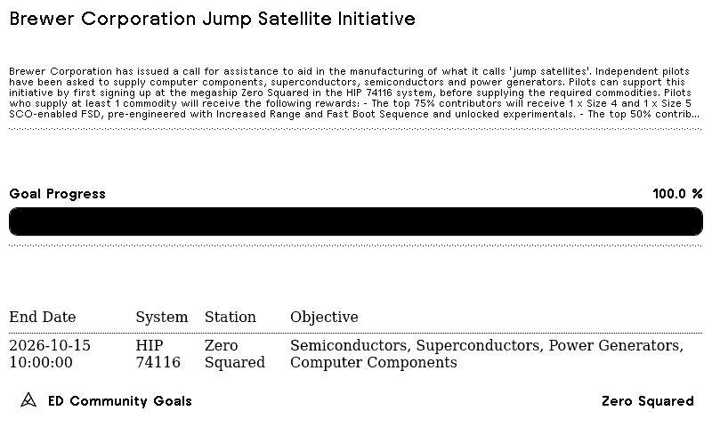

# ED Community Goals



A [TRMNL](https://trmnl.com) e-ink display plugin that shows progress on the current Elite Dangerous community goal.

## Repository and deployment

The plugin source lives in `src/`:

- `settings.yml` - the plugin definition, including the plugin id and the pinned Framework CSS version.
- `shared.liquid` - the shared progress calculation, plus the progress bar, empty state and title bar components.
- `full.liquid`, `half_horizontal.liquid`, `half_vertical.liquid`, `quadrant.liquid` - one layout per screen size.

Data comes from the public Elite Dangerous initiatives API (`https://api.orerve.net/2.0/website/initiatives/list?lang=en`, no authentication), which the plugin polls.

This repository is the source of truth for the live plugin. The workflow in `.github/workflows/trmnl.yml` runs `lint` and `test` on every pull request. On merge to `main` it runs `push`, which deploys to the live TRMNL plugin with `trmnlp push --force` using the `TRMNL_API_KEY` repository secret.

All changes go through a pull request to deploy. Avoid editing the plugin in the TRMNL web editor, because the next deploy overwrites those edits.

## Development

Tooling is [`trmnlp`](https://github.com/usetrmnl/trmnlp) (Ruby gem `trmnl_preview`).

### Prerequisites

Use either:

- Docker, with no install needed. The examples below use the `trmnl/trmnlp` image.
- The gem: `gem install trmnl_preview` (needs a recent Ruby). Then run `trmnlp <command>` directly instead of the Docker form.

The Docker form of every command is:

```sh
docker run --rm --volume "$PWD:/plugin" trmnl/trmnlp <command>
```

`"$PWD"` works in bash, zsh and fish. Run all commands from the repository root.

### Local config

`trmnlp` will not run without a `.trmnlp.yml` file at the repository root. That file is git-ignored. Two examples are provided; copy one to get started:

```sh
cp .trmnlp.yml.example .trmnlp.yml
```

- `.trmnlp.yml.example` - includes sample data for one community goal.
- `.trmnlp.yml.no-goals.example` - an empty goals list, for previewing the "No active community goal" state.

The `variables.activeInitiatives` entry in `.trmnlp.yml` overrides what the plugin polls. Remove that entry and the preview uses the live API instead.

To preview the no-goals state:

```sh
cp .trmnlp.yml.no-goals.example .trmnlp.yml
```

### Live preview

```sh
docker run --rm -it --publish 4567:4567 --volume "$PWD:/plugin" trmnl/trmnlp serve
```

Then open <http://localhost:4567>. The preview reloads when files in `src/` or `.trmnlp.yml` change. With the gem installed, run `trmnlp serve`.

### Static renders

```sh
docker run --rm --volume "$PWD:/plugin" trmnl/trmnlp build --png --color-depth=2
```

This writes an HTML file and a PNG for each layout into `_build/` (git-ignored). `--color-depth=2` matches a 2-bit TRMNL screen.

### Lint

```sh
docker run --rm --volume "$PWD:/plugin" trmnl/trmnlp lint
```

### Tests

```sh
./test/render_test.sh
```

The script renders every layout against the fixtures in `test/fixtures/` and checks the output. The fixtures cover an active goal, a goal over its target, a zero target, an empty goals list and no data. For each it checks that the render has no `NaN`, `Infinity` or Liquid errors, that the title bar icon is present, and that the goal title, percentage and bar width (or the empty state message) are as expected. It uses static data, so it does not call the live API, and it uses `trmnlp` if installed, otherwise Docker.

### Limits of local rendering

Local output can differ slightly from the device. Keep the Docker image current with `docker pull trmnl/trmnlp`, and do a final check on the device.
